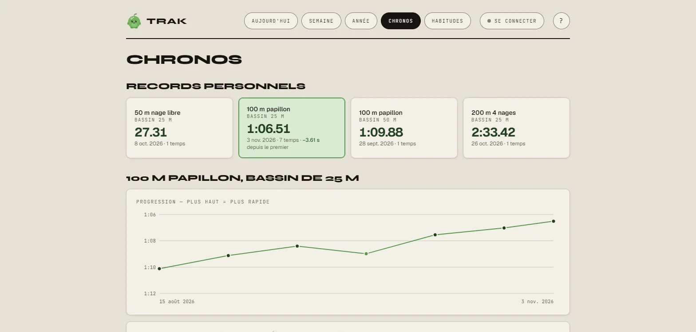

# Trak

Carnet de natation : les habitudes d'entraînement au quotidien, les mètres nagés et les chronos,
épreuve par épreuve. Un compte, plusieurs appareils, les mêmes données partout.
Fonctionne hors ligne et se resynchronise au retour du réseau. Je l'utilise tous les jours —
c'est d'ailleurs pour ça qu'il existe.

En ligne : https://dunandchatellet.fr/Trak/trak.html

## Ce que ça fait

Trois onglets et un écran de réglages, dans une seule page :

| Vue | Contenu |
| --- | --- |
| Aujourd'hui | Cocher ses habitudes, mètres nagés (jusqu'à trois séances le même jour), note du jour, série en cours, volume et objectifs de la semaine. Les flèches ouvrent les jours passés pour les compléter |
| Bilan · Semaine | Les sept jours d'un coup d'œil, les notes, et la part des objectifs tenus sur les quatre dernières semaines |
| Bilan · Saison | La saison sportive (1er septembre → 31 août) : une case par jour, kilomètres nagés, volume semaine par semaine, séries en cours |
| Chronos · Records | Temps par épreuve et par bassin (25 / 50 m), temps de passage, records personnels, objectif de temps, courbe de progression ; chaque temps se modifie. Export CSV et fiche PDF pour l'entraîneur |
| Chronos · Compétitions | Compétitions à venir (compte à rebours, épreuves engagées, temps limites) et passées, avec les temps qui y ont été nagés. Après une compétition, une carte propose d'entrer ses temps |
| Réglages | Habitudes (créer, renommer, objectif par semaine, « compter les mètres »), sauvegarde complète en fichier et restauration, compte |

Une série compte les **semaines** d'affilée où l'objectif de l'habitude est tenu : cinq
séances sur sept suffisent pour un objectif de cinq, un jour de repos ne casse rien.
Les temps de **relais** (départ lancé) sont gardés dans l'historique mais ne comptent jamais
pour un record ni pour un objectif.

Trois habitudes de nageur sont proposées au départ — séance de natation (avec la distance),
prépa physique, étirements — et se remplacent librement.

**Une mascotte** accompagne le suivi : une créature ronde à trois humeurs, qui gagne des
tenues avec les kilomètres nagés dans la saison (pêche à 10 km, écharpe à 25, lunettes à 50,
bleuet à 100, chapeau à 150, lavande à 250, doré à 400, couronne à 600, cape à 1 000). Une
tenue gagnée le reste la saison suivante. Elle est gardée par appareil, dans le navigateur.

**Utilisable sans réseau** : `manifest.json` et `sw.js` rendent Trak installable sur l'écran
d'accueil ; la page, les polices et les icônes restent en cache, les saisies attendent le réseau.

**Une visite guidée** en cinq étapes se lance à la première ouverture, et se rejoue depuis le
bouton « ? » de l'en-tête.

## Comment c'est fait

Front : une seule page HTML (`trak.html`), sans framework ni dépendance.
Back : PHP **sans base de données** — les données vivent dans des fichiers JSON sous
`api/data/`, avec un verrou global et des écritures atomiques pour qu'une synchronisation
interrompue ne laisse jamais un fichier à moitié écrit.

| Fichier | Rôle |
| --- | --- |
| `trak.html` | L'application entière |
| `sw.js` | Copie hors ligne de la page, des polices et des icônes |
| `api/auth.php` | Inscription, connexion, jetons, suppression du compte |
| `api/store.php` | Lecture et écriture des données |
| `api/sync.php` | Fusion entre appareils |
| `api/_core.php` | Réglages communs, garde-fous, erreurs |

L'architecture du back est détaillée dans [`api/LISEZMOI.md`](api/LISEZMOI.md).

### Sécurité

- L'API **refuse les connexions non chiffrées** (403) : sans ça, un mot de passe tapé sur
  `http://` circulerait en clair. `api/.htaccess` a son propre moteur de réécriture, donc la
  redirection https du site ne s'y applique pas.
- Mot de passe de 8 caractères minimum, jetons valables un an, tentatives de connexion
  limitées.
- Nombre de comptes plafonné (`TRAK_MAX_ACCOUNTS`) : c'est un hébergement mutualisé
  personnel, pas un service ouvert.
- Chacun supprime son compte lui-même (mot de passe exigé) : l'adresse, les sessions et
  le fichier de données disparaissent du serveur.
- `api/data/` n'est pas versionné : il contient les comptes et les données réelles.

## Honnêteté sur la fabrication

**Ce projet a été codé avec l'aide d'une IA.** Je ne maîtrise ni le PHP ni le JavaScript à ce
niveau-là. Ce qui vient de moi : l'idée et le cahier des charges, les choix de fonctionnement
et de design, les tests, les corrections et la mise en ligne — et je continue de le faire
évoluer. Je préfère le dire que le laisser croire.

## Installation

Déposer `trak.html` et le dossier `api/` côte à côte sur un hébergement PHP 7.4 ou plus
récent, servi en HTTPS, avec `manifest.json`, `sw.js`, `fonts/` et `Image/`. Le dossier
`api/data/` est créé tout seul à la première inscription.

Détails dans [`api/LISEZMOI.md`](api/LISEZMOI.md).

---

Pierre Dunand-Chatellet — [tous mes projets](https://dunandchatellet.fr/projets.html)
